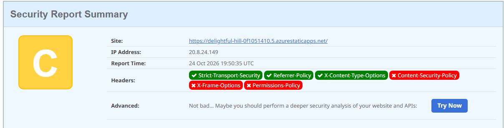
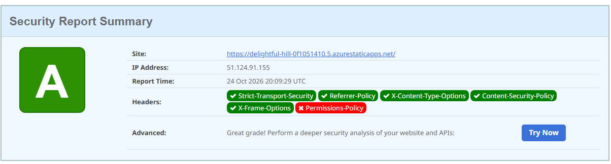

# Despliegue de la Pokédex en Azure

Aquí explico cómo publicamos la app en la nube y **por qué** tomamos cada decisión.

## Idea general

1. El código vive en **GitHub** (`GEliasDev/pokedex`, rama `main`).
2. En Azure creamos un **Static Web App** y lo conectamos a ese repo.
3. Azure crea solito un *workflow* de **GitHub Actions**. Cada vez que hacemos `push` a `main`, GitHub compila la app Angular y Azure la publica.

**Decisión:** usamos **Static Web Apps** y no una Máquina Virtual ni App Service, porque la Pokédex es solo frontend (archivos estáticos) y consume una API externa (PokéAPI). No necesitamos servidor propio, y así sale gratis y más fácil.

## Antes de empezar

- Cuenta de Azure lista (ver [README.md](README.md)).
- Código subido a GitHub.
- Que compile en local: `npm install` y luego `npm run build`.

## Paso 1: Crear el recurso en Azure

En [portal.azure.com](https://portal.azure.com) busca **"Static Web Apps"** → **Crear**.

| Campo | Qué pusimos | Por qué |
|---|---|---|
| Suscripción | La activa de la cuenta | Es la que paga (o el crédito gratis). |
| Grupo de recursos | `rg-pueblopaletainc-prod` | La "carpeta" del proyecto, fácil de borrar al final. Nombre: `rg` (resource group) + proyecto + ambiente `prod`. |
| Nombre | `swa-pokedex-portal-prod` | `swa` = *Static Web App*, `pokedex-portal` = qué es, `prod` = ambiente. Mismo estilo de nombres que el grupo de recursos. |
| Tipo de plan | **Gratuito (Free)** | Alcanza de sobra para un proyecto de la uni. |
| Región | La más cercana disponible | Menos latencia. En el plan gratis la app igual se sirve globalmente. |
| Origen del despliegue | **GitHub** | Para que se actualice solo con cada `push`. |

## Paso 2: Conectar GitHub

Azure te pide **iniciar sesión con GitHub** y autorizar. Después eliges:

- **Organización:** tu usuario (`GEliasDev`)
- **Repositorio:** `pokedex`
- **Rama:** `main`

**Decisión:** rama `main` porque es la principal; así lo que esté ahí es lo que se publica.

## Paso 3: Detalles de compilación

Esta fue la parte que más dudas dio. Esto es lo que va:

| Campo | Valor | Por qué |
|---|---|---|
| Valores preestablecidos | **Angular** | Azure ya sabe cómo compilar Angular. |
| Ubicación de la aplicación | `/` | El `package.json` y `angular.json` están en la raíz del repo, no en una subcarpeta. |
| Ubicación de la API | *(vacío)* | No tenemos backend propio; la API es la externa PokéAPI. |
| Ubicación de salida | `dist/pokedex-angular` | Es donde Angular deja los archivos ya compilados. Sale de `outputPath` en `angular.json`. |

> ⚠️ Si pones mal la ubicación de salida, el despliegue "funciona" pero la página sale en blanco o con error 404. Esta ruta tiene que coincidir con `angular.json`.

## Paso 4: Revisar y crear

Le das a **Revisar y crear** → **Crear**. Azure:

1. Crea el recurso.
2. Mete un archivo en `.github/workflows/` de tu repo (un commit automático).
3. Lanza el primer build.

Puedes ver el avance en la pestaña **Actions** del repo en GitHub.

## Paso 5: Ajustes para que Angular funcione bien en Azure

### a) No usar el `base-href` de GitHub Pages

El script `predeploy` del `package.json` usa `--base-href=/pokedex-angular/`, pensado para GitHub Pages. **En Azure la app vive en la raíz (`/`)**, así que ese script no se usa. Azure compila con el comando normal de build.

**Decisión:** dejamos el script como está (no estorba) pero no lo usamos para Azure.

### b) Rutas de Angular (evitar 404 al recargar)

Angular maneja las rutas en el navegador. Si recargas en `/pokemon/25`, Azure busca ese archivo, no lo encuentra y da 404. Se arregla con un archivo `staticwebapp.config.json` que mande todo a `index.html`:

```json
{
  "navigationFallback": {
    "rewrite": "/index.html",
    "exclude": ["/*.{css,js,png,jpg,svg,ico,webp,woff2}"]
  }
}
```

Va en `src/` y hay que agregarlo a `assets` en `angular.json` para que termine dentro de `dist/pokedex-angular`.

### c) Reto 1: las imágenes no cargaban (error 404)

**El problema:** al abrir la página principal, las imágenes de los Pokémon no salían y la consola del navegador mostraba:

```
GET https://delightful-hill-0f1051410.5.azurestaticapps.net/pokedex-angular/assets/images/pokemon-green.png 404 (Not Found)
```

**La causa:** fíjate en la URL: tiene `/pokedex-angular/` en medio. El proyecto original estaba pensado para GitHub Pages, donde la app se sirve en una subcarpeta (`usuario.github.io/pokedex-angular/`). Por eso en `src/environments/environment.prod.ts` la ruta de las imágenes estaba escrita a mano así:

```ts
imagesPath: '/pokedex-angular/assets/images',
```

En Azure la app vive en la raíz del dominio, entonces esa carpeta `/pokedex-angular/` no existe y da 404.

**La decisión:** cambiar la ruta para que apunte a la raíz, igual que ya estaba en el ambiente de desarrollo (`environment.ts`):

```ts
imagesPath: '/assets/images',
```

Cambiamos `environment.prod.ts` porque es el archivo que Angular usa cuando compila en modo producción (que es lo que hace Azure). En local con `npm start` nunca falló porque ahí se usa `environment.ts`, que ya tenía la ruta bien.

**Después del cambio:** hacer `git commit` y `git push` a `main` para que GitHub Actions vuelva a compilar y Azure publique la versión corregida. Luego recargar la página con `Ctrl + F5` (para saltarse la caché) y comprobar que las imágenes cargan.

## Paso 6: Probar

En el portal, dentro del recurso, aparece la **URL** (algo como `https://xxxx.azurestaticapps.net`). Ábrela y revisa:

- Carga el listado de Pokémon.
- Entra al detalle de uno.
- Recarga en el detalle y no sale 404.

## Cómo se actualiza después

Haces cambios → `git push` a `main` → GitHub Actions compila → Azure publica. No hay que hacer nada más.

## Problemas comunes

| Síntoma | Causa probable |
|---|---|
| Página en blanco | Ubicación de salida mal puesta o `base-href` incorrecto. |
| 404 al recargar una ruta | Falta `staticwebapp.config.json`. |
| Falla el build en Actions | Versión de Node distinta; Angular 14 funciona con Node 18 o menor. Revisar el log. |
| No cargan los Pokémon | Revisar la consola del navegador; puede ser un problema con PokéAPI. |

## Reto 2: seguridad de la página (meta: A+)

El profe nos pasó [securityheaders.com](https://securityheaders.com/), una web que revisa los **headers de seguridad** (unas cabeceras que el servidor manda junto con la página y que le dicen al navegador qué se permite y qué no). Te pone una nota de la F a la A+. Nuestra meta es llegar a **A+**.

### Estado inicial (recién desplegado)

Analizamos `https://delightful-hill-0f1051410.5.azurestaticapps.net/` apenas quedó publicada, sin tocar nada de seguridad:



**Nota inicial: C.**

| Header | Estado | Qué hace (en cristiano) |
|---|---|---|
| Strict-Transport-Security | ✅ Ya estaba | Obliga al navegador a usar siempre HTTPS. |
| Referrer-Policy | ✅ Ya estaba | Controla cuánta info de dónde vienes se manda al abrir otros links. |
| X-Content-Type-Options | ✅ Ya estaba | Evita que el navegador "adivine" el tipo de archivo y ejecute algo que no es. |
| Content-Security-Policy | ❌ Falta | Define de dónde puede cargar scripts, imágenes, estilos, etc. Es el más importante. |
| X-Frame-Options | ❌ Falta | Evita que otra página meta la nuestra en un `iframe` (ataque de clickjacking). |
| Permissions-Policy | ❌ Falta | Apaga funciones del navegador que no usamos (cámara, micrófono, ubicación...). |

Los tres que ya estaban los puso Azure por defecto. Nos toca agregar los otros tres.

*(Los cambios y decisiones de este reto se van agregando abajo, uno por uno.)*

### Paso 1: Content-Security-Policy (CSP)

**¿Qué es?** Es una lista de "permisos" que le mandamos al navegador: de qué sitios puede cargar scripts, imágenes, fuentes, estilos y a qué servidores puede hacer peticiones. Si alguien logra meter un script malicioso en la página (ataque XSS), el navegador lo bloquea porque no está en la lista. Es el header más importante y el que más cuesta, porque si la lista queda mal la página se rompe.

**¿Cómo lo mandamos?** En Azure Static Web Apps los headers se configuran en un archivo llamado `staticwebapp.config.json`, dentro de la sección `globalHeaders` (headers que se mandan en todas las respuestas).

#### Primero: investigar qué carga la app

Antes de escribir la política revisamos el código para saber a qué sitios externos se conecta la app. Esto fue lo que encontramos:

| Qué carga la app | De dónde | Dónde lo vimos | Directiva que lo permite |
|---|---|---|---|
| Scripts de Angular | Nuestro propio dominio | archivos `.js` generados en el build | `script-src 'self'` |
| Datos de los Pokémon (REST) | `https://pokeapi.co` | `environment.prod.ts` → `pokeApi` | `connect-src` |
| Datos de los Pokémon (GraphQL) | `https://beta.pokeapi.co` | `environment.prod.ts` → `pokeApiGraphQL`, usado en `core/graphql.module.ts` | `connect-src` |
| Fuente Roboto (CSS) | `https://fonts.googleapis.com` | `assets/styles/base/_typography.scss` (`@import url(...)`) | `style-src` |
| Fuente Roboto (archivo de la letra) | `https://fonts.gstatic.com` | lo descarga el CSS de Google | `font-src` |
| Fuente Pokémon (`pokemon-gb.ttf`) | Nuestro dominio | `assets/fonts` | `font-src 'self'` |
| Imágenes del listado (sprites) | Nuestro dominio (`/assets/images`) | `data/mocks/pokedex-versions.mock.ts` | `img-src 'self'` |
| Artwork oficial de cada Pokémon | `https://raw.githubusercontent.com` | viene de la API en `pokemon.mapper.ts` (`official-artwork`) | `img-src` |
| Imagen del Pokémon en el detalle | `https://assets.pokemon.com` | `pokemon-specie.mapper.ts` línea 40 | `img-src` |

#### La política que armamos

```
default-src 'self';
script-src 'self';
style-src 'self' 'unsafe-inline' https://fonts.googleapis.com;
font-src 'self' https://fonts.gstatic.com;
img-src 'self' https://raw.githubusercontent.com https://assets.pokemon.com;
connect-src 'self' https://pokeapi.co https://beta.pokeapi.co;
object-src 'none';
base-uri 'self';
form-action 'self';
frame-ancestors 'none'
```

Qué hace cada línea:

- `default-src 'self'`: regla por defecto, solo se permite lo que venga de nuestro propio dominio. Todo lo que no mencionemos abajo cae aquí.
- `script-src 'self'`: solo se ejecutan scripts de nuestro dominio. **Sin `unsafe-inline`**, o sea, no se permiten scripts escritos dentro del HTML. (Esto es lo que más pesa en la nota.)
- `style-src ... 'unsafe-inline'`: estilos propios + Google Fonts. Aquí **sí** dejamos `unsafe-inline` (ver "Decisiones" abajo).
- `font-src`: fuentes propias + las de Google.
- `img-src`: imágenes propias + las dos páginas externas que usa la API.
- `connect-src`: a qué APIs se puede conectar la app (PokéAPI REST y GraphQL).
- `object-src 'none'`: prohíbe `<object>`, `<embed>` y plugins viejos (Flash y cosas así).
- `base-uri 'self'`: nadie puede cambiar la etiqueta `<base>` para redirigir las rutas.
- `form-action 'self'`: los formularios solo pueden enviar datos a nuestro dominio.
- `frame-ancestors 'none'`: nadie puede meter nuestra página en un `iframe`. (Hace lo mismo que X-Frame-Options, que arreglamos después.)

#### Cambios en el proyecto (archivo por archivo)

**1. Archivo nuevo: `src/staticwebapp.config.json`**

Contiene la política dentro de `globalHeaders`. Es el archivo que Azure lee para saber qué headers mandar.

**2. `angular.json` (2 cambios)**

- En `architect.build.options.assets` agregué `"src/staticwebapp.config.json"`. Sin esto Angular **no copia** el archivo a `dist/pokedex-angular`, y Azure nunca lo vería (el build solo copia lo que esté listado en `assets`).
- En `architect.build.configurations.production` agregué:

  ```json
  "optimization": {
    "scripts": true,
    "styles": { "minify": true, "inlineCritical": false },
    "fonts": true
  }
  ```

  El importante es `inlineCritical: false`. Por defecto Angular 14 en producción mete CSS "crítico" dentro del HTML y carga el resto con un truco: `<link media="print" onload="this.media='all'">`. Ese `onload` es JavaScript escrito dentro del HTML, y con nuestro `script-src 'self'` el navegador lo bloquearía (y los estilos no cargarían bien). Al apagarlo, Angular carga el CSS normal con un `<link>` y no hay scripts dentro del HTML. Los otros valores (`scripts`, `minify`, `fonts`) los puse en `true` porque es lo que ya hacía por defecto; al definir el objeto `optimization` hay que escribirlos para no perderlos.

**3. `src/index.html` (se borró un bloque)**

Se eliminó el `<script>` que estaba entre los comentarios "Start/End Single Page Apps for GitHub Pages". Es un truco del proyecto original para que las rutas funcionen en GitHub Pages (que no soporta SPA). Dos razones para quitarlo:

- En Azure no sirve para nada: eso lo resuelve Azure con su propia configuración.
- Es un script **dentro del HTML**, y nuestro CSP no lo deja correr. Dejarlo habría generado un error en la consola.

Sin ese código no se perdió ninguna función de la app, solo se quitó código de GitHub Pages.

#### Decisiones que tomamos

1. **No usar `'unsafe-inline'` en `script-src`.** Es la forma fácil de que "todo funcione", pero deja la política casi inútil contra XSS y securityheaders.com baja la nota. Preferimos arreglar la causa (el `onload` y el script en el HTML) que aflojar la política.
2. **Sí dejar `'unsafe-inline'` en `style-src`.** Angular crea etiquetas `<style>` al vuelo para los estilos de cada componente. Para evitarlo se necesita un *nonce* (un código aleatorio distinto en cada visita) que genera un servidor, y una Static Web App no tiene servidor que lo genere. Es un riesgo mucho menor que en scripts (con estilos no se puede ejecutar código). Si el profe pide más, lo revisamos.
3. **Quitar `data:` de `img-src`.** Revisando el código no encontramos imágenes embebidas, así que no se permite. Mientras menos permisos, mejor. Si alguna imagen no carga, es lo primero que se prueba.
4. **Poner las APIs y dominios exactos**, no comodines como `https://*`. Solo se permite lo que la app usa de verdad.
5. **Dejar fuera `navigationFallback`** (el arreglo del 404 al recargar rutas). No es parte de este paso; se hace aparte cuando se decida.

#### Cómo verificar

1. Hacer `git commit` y `git push` a `main`, y esperar que termine el Action en GitHub.
2. Abrir la página, apretar `F12` → pestaña **Console** y recargar con `Ctrl + F5`. Si el CSP bloquea algo sale un error rojo tipo `Refused to load ... because it violates the following Content Security Policy directive`. El error dice qué directiva falta.
3. Revisar que carguen: listado, imágenes, detalle de un Pokémon y las letras.
4. Volver a pasar la URL por [securityheaders.com](https://securityheaders.com/) y comprobar que Content-Security-Policy ya salga en verde.

#### Resultado del Paso 1

Hicimos `commit` y `push` a `main`, esperamos que el Action terminara y volvimos a analizar la página (con la caché de securityheaders.com limpia):



**La nota subió de C a A.**

| Header | Antes | Ahora |
|---|---|---|
| Strict-Transport-Security | ✅ | ✅ |
| Referrer-Policy | ✅ | ✅ |
| X-Content-Type-Options | ✅ | ✅ |
| Content-Security-Policy | ❌ | ✅ **(lo arreglamos en este paso)** |
| X-Frame-Options | ❌ | ✅ **(se arregló "de regalo")** |
| Permissions-Policy | ❌ | ❌ (falta) |

**¿Por qué cambiaron dos si solo tocamos uno?** Porque en nuestro CSP pusimos `frame-ancestors 'none'`, que le dice al navegador que nadie puede meter la página en un `iframe`. Eso es exactamente lo que hace X-Frame-Options, y securityheaders.com lo reconoce como equivalente, así que marcó los dos en verde.

**Nota para ser honestos:** `frame-ancestors` es la forma moderna y es la que manda en los navegadores actuales. X-Frame-Options es la versión vieja, que todavía sirven navegadores antiguos. Por ahora la página ya cuenta como protegida, y más adelante podemos decidir si también agregamos el header `X-Frame-Options` clásico por compatibilidad.

**Lo que sigue:** solo falta **Permissions-Policy** para intentar llegar a **A+**.

### Paso 2: Permissions-Policy

**¿Qué es?** Es un header que apaga funciones del navegador que la página no necesita (cámara, micrófono, ubicación, pagos, etc.). Aunque alguien lograra meter código raro en la página, o un `iframe` de terceros, no podría activar esas funciones. Es el principio de "mientras menos permisos, mejor".

**Sintaxis:** `funcion=()` significa "nadie puede usar esta función, ni siquiera nuestra propia página". El `()` vacío es la lista de sitios permitidos, y está vacía.

#### Primero: investigar qué usa la app

Buscamos en todo `src/` (archivos `.ts` y `.html`) si el código usa alguna función del navegador que requiera permiso: `geolocation`, `getUserMedia`, `mediaDevices` (cámara/micro), `clipboard`, `Notification`, `requestFullscreen`, `speechSynthesis`, `bluetooth`, `usb`, `vibrate`, `DeviceOrientation`, `<video>` y `<audio>`.

**Resultado: no usa ninguna.** Lo único que salió fueron falsos positivos (la palabra "usb" aparece dentro de `StatusBarComponent`, que es una barra de estado de la app y no tiene nada que ver con USB). La Pokédex solo muestra listas, imágenes y texto, así que podemos apagar todo sin riesgo de romper algo.

#### Lo que agregamos

En `src/staticwebapp.config.json`, dentro de `globalHeaders`, al lado del CSP:

```json
"Permissions-Policy": "accelerometer=(), autoplay=(), camera=(), display-capture=(), geolocation=(), gyroscope=(), magnetometer=(), microphone=(), midi=(), payment=(), usb=()"
```

| Función apagada | Para qué sirve (en cristiano) |
|---|---|
| `accelerometer`, `gyroscope`, `magnetometer` | Sensores de movimiento del celular. |
| `autoplay` | Reproducir audio/video solo, sin que el usuario toque algo. |
| `camera`, `microphone` | Cámara y micrófono. |
| `display-capture` | Grabar o compartir la pantalla. |
| `geolocation` | Ubicación del usuario. |
| `midi` | Instrumentos musicales conectados. |
| `payment` | API de pagos del navegador. |
| `usb` | Dispositivos USB. |

#### Cambios en el proyecto (archivo por archivo)

- **`src/staticwebapp.config.json`**: se agregó la línea `Permissions-Policy` dentro de `globalHeaders`. Es el **único** archivo de código que cambió. No hubo que tocar `angular.json` porque ese archivo ya se copia al build desde el Paso 1.

#### Decisiones que tomamos

1. **Apagar solo las funciones que existen y son comunes** (las de la tabla), en vez de listar las ~40 que hay. Cubre lo importante y el header se mantiene corto y legible.
2. **Usar `()` vacío** y no `(self)`, porque la app no usa ninguna de estas funciones ni siquiera por su cuenta. Si más adelante se agrega, por ejemplo, un botón de "compartir ubicación", ahí se cambia esa función a `(self)`.
3. **Revisar el código primero** antes de apagar nada, para no romper una función que sí se use sin darnos cuenta.

#### Cómo verificar

1. `git push` a `main` y esperar el Action en GitHub.
2. `F12` → **Network** → recargar → clic en el documento principal → **Response Headers**: debe aparecer `permissions-policy`.
3. Pasar la URL por [securityheaders.com](https://securityheaders.com/) con la caché limpia y ver si ya sale **A+**.

> 📸 Pendiente: captura del resultado de este paso (`docs/img/03-security-headers-permissions.png`).

## Limpieza (importante)

Cuando termine la entrega, borra el grupo de recursos `rg-pueblopaletainc-prod` desde el portal para que no quede nada activo.
